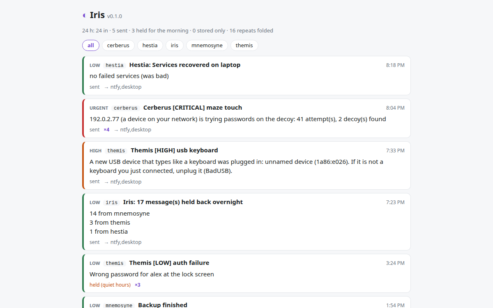

# Iris


**Iris is one inbox for the notifications of all your home tools.** It speaks
[ntfy](https://ntfy.sh)'s publish protocol on `127.0.0.1:8090`, so any tool
that can push to ntfy can push to Iris instead: change one URL, nothing else.
Iris then decides what actually reaches you:

- **Repeats are folded.** The same title and text within 30 minutes is counted
  (`×4`), not sent four times.
- **Quiet hours.** At night only `high` and `urgent` messages go out; the rest
  waits for **one morning digest** ("17 messages held back overnight: 14 from
  mnemosyne, 3 from themis…").
- **Per-topic minimum.** "Backup finished" can be stored without ever buzzing.
- **Delivery that does not lose or double.** To your phone through ntfy and/or
  to this computer's desktop (`notify-send`); a failed delivery is retried, and
  a message one output took is never sent again.
- **Everything is kept** (90 days) in an inbox page, with what happened to
  each message.



It was made for the tools next to it:
[Cerberus](https://github.com/fas0ftware/cerberus) (network watch),
[Themis](https://github.com/fas0ftware/themis) (journal watch),
[Hestia](https://github.com/fas0ftware/hestia) (health check), each of which
pushes to ntfy.

## Install

Python 3.11+, no dependencies.

```sh
git clone https://github.com/fas0ftware/iris && cd iris
./contrib/install.sh       # systemd user service on 127.0.0.1:8090, settings in ~/.config/iris/config.toml
```

Then point your tools at it, one topic each:

```sh
THEMIS_NTFY_URL=http://127.0.0.1:8090/themis      # ~/.config/themis/env
HESTIA_NTFY_URL=http://127.0.0.1:8090/hestia      # ~/.config/hestia/env
CERBERUS_NTFY_URL=http://127.0.0.1:8090/cerberus  # cerberus/.env
curl -H "Title: Hello" -d "from a script" http://127.0.0.1:8090/scripts
```

Open <http://127.0.0.1:8090/> for the inbox.

## Settings

`~/.config/iris/config.toml`, every key optional:

```toml
[deliver]
ntfy = "https://ntfy.sh/a-long-random-topic"   # your phone; "" = none
desktop = true                                  # notify-send here

[quiet]
hours = "23-07"
pass = "high"          # at night, only this and above goes out

[dedup]
minutes = 30

[digest]
at = "08:00"           # "" = never

[topics.mnemosyne]
min = "default"        # below this: stored, never delivered
```

Priorities are ntfy's: `min`, `low`, `default`, `high`, `urgent` (or 1–5).

## Commands

| Command | Does |
|---|---|
| `iris serve [--host H] [--port P]` | The endpoint, the inbox page, delivery and the digest |
| `iris send TOPIC "text" [--title T] [--priority P]` | Publish one message (to test your rules) |
| `iris inbox [--topic T] [-n N]` | Recent messages in the terminal |
| `iris status [--save [PATH]]` | Last 24 hours; `--save` writes `~/.local/state/iris/status.json` |
| `iris demo [--db PATH]` | Fictional messages for trying the page |

### API

| | |
|---|---|
| `POST` or `PUT /<topic>` | Publish, like ntfy: the body is the text; `Title`, `Priority`, `Tags`, `Click` headers (also `X-Title`… and ntfy's short forms) |
| `GET /api/messages[?topic=]` | The last 200 messages |
| `GET /api/status` | Counts for 24 hours and messages still waiting |
| `GET /healthz` | `{"ok": true}` |

## Security

- **Loopback by default.** Listening on another address needs `IRIS_TOKEN`
  (16+ characters); every request then has to carry
  `Authorization: Bearer <token>` (what ntfy clients send for an access token),
  and the page trades a `?token=` for an HttpOnly cookie once.
- **No publishing from web pages.** A publish with an `Origin` header is
  refused, so a site you visit cannot post into your inbox from the browser.
- **Hostile text stays text.** Messages quote what devices and attackers sent
  (an SSH user name, a banner): control characters are removed, sizes capped
  (4 KB body, 200-character title), a `Click` link is kept only if it is
  http(s), the page inserts everything with `textContent` under a strict CSP,
  and desktop notifications get the body markup-escaped.
- **Owner-only storage** (`0600`), 90 days, then trimmed.

## Tests

```sh
python3 -m venv .venv && .venv/bin/pip install -r requirements-dev.txt
.venv/bin/python -m pytest -q
```

11 tests: priorities and quiet hours across midnight, the config file and its
errors, ntfy headers (long and short names, a `javascript:` click, escape
codes), folding repeats inside and outside the window, quiet hours and topic
minimums, retries that never double-send and one working output being enough,
the morning digest (not before its time, once a day), the real HTTP server
(publish, PUT, a bad topic, a cross-origin publish, an oversized body, the
inbox, the page, the CSP), the token beyond loopback, and the CLI. CI also
publishes to a running server with `curl`, and runs bandit.

## Roadmap

- Actions in phone notifications (mute a device in Cerberus from the alert).
- Rules by text ("ignore *Backup finished* unless it failed").
- A weekly summary next to the daily digest.

## License

[MIT](LICENSE)
