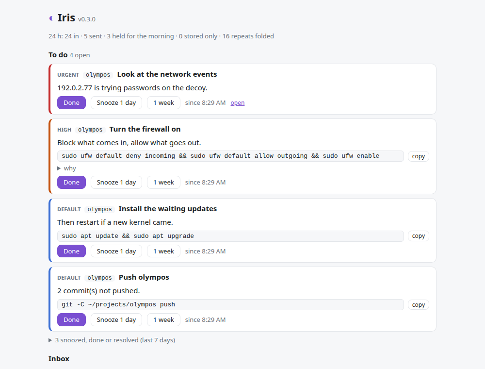
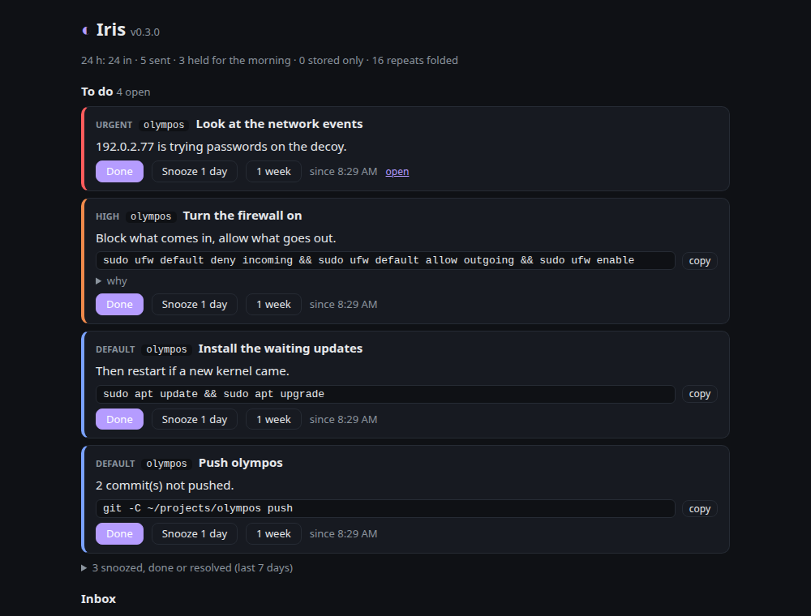

# Iris


**Iris is one inbox for the notifications of all your home tools.** It speaks
[ntfy](https://ntfy.sh)'s publish protocol on `127.0.0.1:8090`, so any tool
that can push to ntfy can push to Iris instead: change one URL, nothing else.
Iris then decides what actually reaches you:

- **Repeats are folded.** The same title and text within 30 minutes is counted
  (`×4`), not sent four times.
- **Quiet hours.** At night only `high` and `urgent` messages go out; the rest
  waits for **one morning digest** ("17 messages held back overnight: 14 from
  mnemosyne, 3 from themis…").
- **Per-topic minimum.** Low-priority messages of a tool can be stored without ever buzzing.
- **Rules by text.** "Backup finished": store it. "Backup *failed*": deliver at once, even at
  night, as urgent. The first matching rule decides.
- **Delivery that does not lose or double.** To your phone through ntfy and/or
  to this computer's desktop (`notify-send`); a failed delivery is retried, and
  a message one output took is never sent again.
- **Everything is kept** (90 days) in an inbox page, with what happened to
  each message.
- **Tasks, not just alerts** (0.3). Tools can also send *what you have to do*
  ("turn the firewall on: `sudo ufw enable`"). Iris keeps them as a to-do list:
  urgent ones arrive at once, the rest come together in **one plan every
  morning**, and a task closes **by itself** when the tool stops reporting it.
  You can tick a task or snooze it. See [Tasks](#tasks).


It was made for the tools next to it:
[Cerberus](https://github.com/fas0ftware/cerberus) (network watch),
[Themis](https://github.com/fas0ftware/themis) (journal watch),
[Hestia](https://github.com/fas0ftware/hestia) (health check), each of which
pushes to ntfy.

## Install

Python 3.11+, no dependencies.

```sh
git clone https://github.com/fas0ftware/iris && cd iris
./contrib/install.sh       # systemd user service on 127.0.0.1:8090, settings in ~/.config/iris/config.toml
```

Then point your tools at it, one topic each:

```sh
THEMIS_NTFY_URL=http://127.0.0.1:8090/themis      # ~/.config/themis/env
HESTIA_NTFY_URL=http://127.0.0.1:8090/hestia      # ~/.config/hestia/env
CERBERUS_NTFY_URL=http://127.0.0.1:8090/cerberus  # cerberus/.env
curl -H "Title: Hello" -d "from a script" http://127.0.0.1:8090/scripts
```

Open <http://127.0.0.1:8090/> for the inbox.

## Settings

`~/.config/iris/config.toml`, every key optional:

```toml
[deliver]
ntfy = "https://ntfy.sh/a-long-random-topic"   # your phone; "" = none
desktop = true                                  # notify-send here

[quiet]
hours = "23-07"
pass = "high"          # at night, only this and above goes out

[dedup]
minutes = 30

[digest]
at = "08:00"           # "" = never

[topics.mnemosyne]
min = "default"        # below this: stored, never delivered
```

### Rules

```toml
[[rules]]                  # the first matching rule decides
topic = "mnemosyne"        # optional
match = "failed"           # case-insensitive, in the title or the body; optional
action = "always"          # store | hold (morning digest) | always (even at night)
priority = "urgent"        # optional: change the priority first

[[rules]]
match = "recovered"
action = "hold"
```

Priorities are ntfy's: `min`, `low`, `default`, `high`, `urgent` (or 1–5).

## Tasks

A tool sends its **whole current list** for its own source; Iris works out what is new, what
went away and what came back:

```bash
curl -X PUT http://127.0.0.1:8090/api/tasks/olympos -H 'Content-Type: application/json' -d '{
  "tasks": [{"id": "aegis:firewall", "title": "Turn the firewall on", "priority": "high",
             "action": "Block what comes in, allow what goes out.",
             "command": "sudo ufw default deny incoming && sudo ufw enable"}]}'
```

| What happens | When |
|---|---|
| **open**, announced at once | a new task with priority `high` or `urgent` |
| **open**, in the morning plan | a new task with a lower priority |
| **gone** | the source sent its list without it: the problem went away, nobody ticks it |
| **done** | you ticked it on the page, with `iris task KEY done` or through the API; if the source still reports it two hours later it opens again, marked *still there* |
| **snoozed** | for a day, a week, any number of hours; then open again |

**Today's plan** goes out once a day at `plan_at` (default 08:30): every open task, urgent first,
each with its command. Fields: `id` (lowercase, `a-z 0-9 : _ . -`, stable for the same
problem), `title`, `action`, `command`, `why`, `link` (http(s) only), `priority`; at most 100
per source. [Olympos](https://github.com/fas0ftware/olympos) turns its findings into tasks
(`olympos tasks --push`), [Chronos](https://github.com/fas0ftware/chronos) opens one when a
commit streak is at risk in the evening.

`GET /api/tasks` with the token is what a phone app reads to show the list and tick tasks.



<details><summary>Dark theme</summary>



</details>

## Commands

| Command | Does |
|---|---|
| `iris serve [--host H] [--port P]` | The endpoint, the inbox page, delivery and the digest |
| `iris send TOPIC "text" [--title T] [--priority P]` | Publish one message (to test your rules) |
| `iris inbox [--topic T] [-n N]` | Recent messages in the terminal |
| `iris status [--save [PATH]]` | Last 24 hours; `--save` writes `~/.local/state/iris/status.json` |
| `iris tasks [--all]` | Open tasks (with `--all` also snoozed, done and recently gone) |
| `iris task KEY done\|snooze\|reopen [--hours H]` | Tick, snooze or reopen a task |
| `iris plan [--send]` | Today's plan now; `--send` delivers it |
| `iris demo [--db PATH]` | Fictional messages for trying the page |

### API

| | |
|---|---|
| `POST` or `PUT /<topic>` | Publish, like ntfy: the body is the text; `Title`, `Priority`, `Tags`, `Click` headers (also `X-Title`… and ntfy's short forms) |
| `GET /api/messages[?topic=]` | The last 200 messages |
| `GET /api/status` | Counts for 24 hours, messages still waiting, tasks by state |
| `PUT /api/tasks/<source>` | A tool's whole task list, JSON `{"tasks": [...]}` |
| `GET /api/tasks[?state=open\|snoozed\|done\|gone\|all]` | Tasks, urgent first |
| `POST /api/task/<key>/done\|snooze\|reopen` | JSON body; `{"hours": 24}` for snooze |
| `GET /healthz` | `{"ok": true}` |

## Security

- **Loopback by default.** Listening on another address needs `IRIS_TOKEN`
  (16+ characters); every request then has to carry
  `Authorization: Bearer <token>` (what ntfy clients send for an access token),
  and the page trades a `?token=` for an HttpOnly cookie once.
- **No publishing from web pages.** A publish with an `Origin` header is
  refused, so a site you visit cannot post into your inbox from the browser.
- **Hostile text stays text.** Messages quote what devices and attackers sent
  (an SSH user name, a banner): control characters are removed, sizes capped
  (4 KB body, 200-character title), a `Click` link is kept only if it is
  http(s), the page inserts everything with `textContent` under a strict CSP,
  and desktop notifications get the body markup-escaped.
- **Task buttons only from the page itself.** Ticking or snoozing from a browser needs an
  `Origin` equal to the address the page was opened at (and, without a token, a loopback
  `Host`), with a JSON body; a tool's task list with any `Origin` is refused. Task texts are
  cleaned like messages, links must be http(s).
- **Owner-only storage** (`0600`), 90 days, then trimmed.

## Tests

```sh
python3 -m venv .venv && .venv/bin/pip install -r requirements-dev.txt
.venv/bin/python -m pytest -q
```

13 tests: priorities and quiet hours across midnight, the config file and its
errors, ntfy headers (long and short names, a `javascript:` click, escape
codes), folding repeats inside and outside the window, quiet hours and topic
minimums, retries that never double-send and one working output being enough,
the morning digest (not before its time, once a day), the real HTTP server
(publish, PUT, a bad topic, a cross-origin publish, an oversized body, the
inbox, the page, the CSP), the token beyond loopback, and the CLI. CI also
publishes to a running server with `curl`, and runs bandit.

## Roadmap

- A phone app for the task list (reads `GET /api/tasks` with the token).
- Actions in phone notifications ("done" and "snooze" from the alert).
- ~~Rules by text~~: done in 0.2.
- A weekly summary next to the daily digest.

## Changelog

- **0.3.0** – Tasks: tools send what to do (`PUT /api/tasks/<source>`), urgent ones are announced, the rest go into a daily plan at `plan_at`; tasks close by themselves, can be ticked or snoozed on the page, in the terminal (`iris tasks`, `iris task`, `iris plan`) and through the API; `[tasks] lang = "tr"` for Turkish messages.
- **0.2.0** – `[[rules]]`: by topic and text, store, hold for the digest or always deliver, and optionally change the priority; the first match wins. The service keeps the status file current for Olympos.
- **0.1.0** – ntfy-compatible inbox: folds repeats, quiet hours with a morning digest, per-topic minimum, ntfy and desktop delivery with retries.

## License

[MIT](LICENSE)
